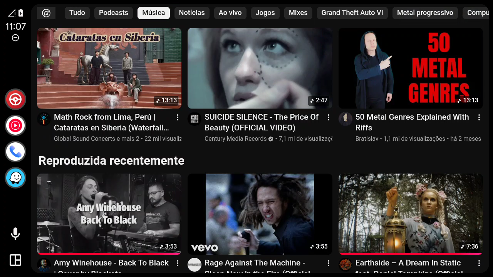
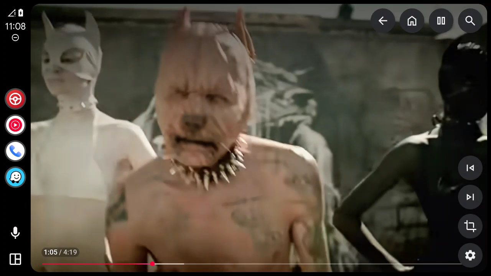
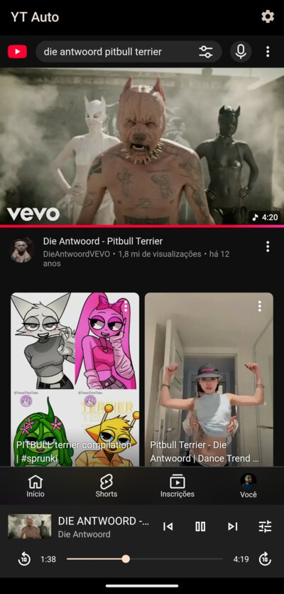
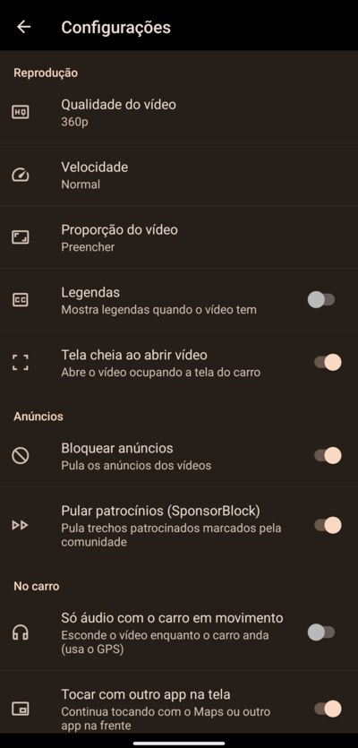
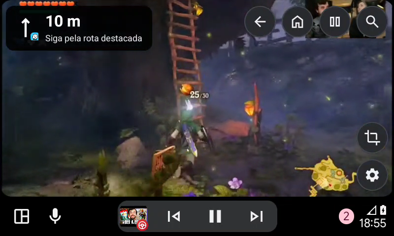
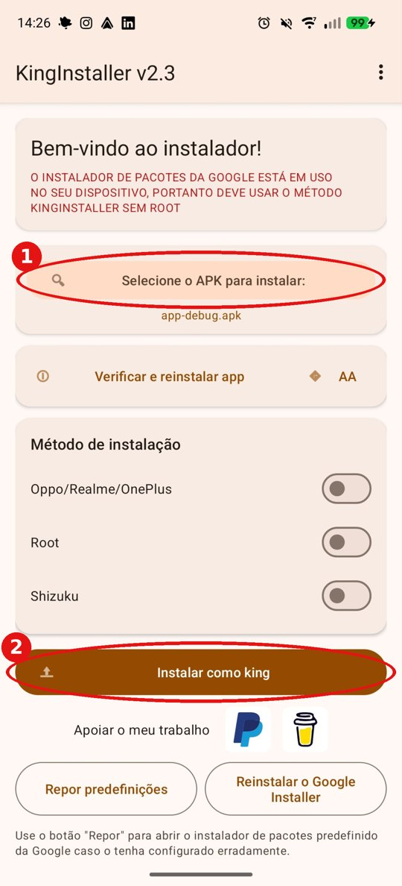

# YT Auto

[](https://github.com/begati/yt-auto/releases)
[](https://github.com/begati/yt-auto/stargazers)
[](https://github.com/begati/yt-auto/releases/latest)
[](LICENSE)

[English](README.md) · [Português (Brasil)](README.pt-BR.md) · **Español**

Mira YouTube en la pantalla del coche con Android Auto. YT Auto muestra el sitio móvil de YouTube en la pantalla
del coche, con tu cuenta, suscripciones e historial, y convierte el teléfono en un control remoto.

> [!WARNING]
> **Ver videos mientras conduces es peligroso y, según el país, puede estar prohibido por ley.**
> Úsalo solo con el coche estacionado, o deja que un pasajero lo controle. **Úsalo bajo tu propio riesgo: el autor
> no se hace responsable** de multas, accidentes, daños ni de ninguna otra consecuencia del uso de esta app.
> Consulta también la [licencia](LICENSE) ("THE SOFTWARE IS PROVIDED AS IS, WITHOUT WARRANTY OF ANY KIND").

| Página principal de YouTube en el coche | Video reproduciéndose en el coche |
|---|---|
|  |  |

| App en el teléfono (YouTube + control remoto) | Ajustes en el teléfono |
|---|---|
|  |  |

| Próximo giro de Waze sobre el video |
|---|
|  |

## Funciones

- Página principal, suscripciones, historial y búsqueda de YouTube en el coche (la búsqueda usa el teclado del coche).
- Gestos en la pantalla del coche: doble toque para saltar 10 s, toque en la barra de progreso para ir a ese punto,
  arrastrar hacia un lado para avanzar o retroceder (consulta [En la pantalla del coche](#en-la-pantalla-del-coche)).
- No necesitas cuenta; inicia sesión una vez en el teléfono (opcional) y el coche usa la misma sesión.
- Control desde el teléfono: toca un video en el teléfono y se reproduce en el coche; reproducir/pausar, siguiente,
  barra de progreso, retroceder/avanzar 10 s y ajustes desde la barra del teléfono.
- Compartir al coche: en la app de YouTube (o en cualquier app), Compartir > YT Auto reproduce el enlace en el coche.
- Voz: "Ok Google, reproduce <algo> en YT Auto" reproduce el primer resultado de la búsqueda.
- Tarjeta "reproduciendo ahora" de Android Auto (con retroceder/avanzar 10 s) y botones del volante
  (reproducir/pausar, siguiente, anterior).
- Historial, Suscripciones, Ver más tarde, Videos que me gustan y tus listas en el explorador de medios de Android Auto.
- El video llena la pantalla del coche por defecto; el botón de proporción (ajustar / rellenar / estirar) recuerda tu
  elección.
- Cuando un video termina y no sigue otro, una cuenta de 5 s vuelve a tu página principal.
- Salta los patrocinios con [SponsorBlock](https://sponsor.ajay.app) (solo se envía un prefijo de 4 caracteres del
  hash del id del video).
- Modo solo audio opcional con el coche en movimiento (usa la velocidad del GPS del teléfono; desactivado por defecto).
- Navegación paso a paso sobre el video: mientras Waze o Google Maps navegan, el próximo giro (icono, distancia e
  instrucción) aparece en la esquina superior de la pantalla del coche. Android Auto oculta su tarjeta con YT Auto
  abierto, así que la app lee la instrucción de su notificación. Activado por defecto; necesita acceso a las notificaciones una vez: en los
  ajustes del teléfono, activa Navegación en pantalla y permítelo. Desactívalo en los ajustes del teléfono o del coche.
- Avisa cuando sale una versión nueva en GitHub.
- Bloquea los anuncios de YouTube (el video empieza sin esperar el anuncio) y oculta los elementos promocionados del feed.
- Ajustes: calidad, velocidad, proporción (ajustar / rellenar / estirar), subtítulos, pantalla completa al abrir,
  página principal, tamaño del texto, navegación en pantalla.
- Retoma el video donde se quedó cuando el coche se vuelve a conectar.
- Idiomas: English, Português (Brasil), Español, Français, Italiano, Deutsch, Polski, Türkçe, Bahasa Indonesia,
  Русский y العربية. La app sigue el idioma del teléfono y usa inglés cuando el idioma no está disponible; en
  Android 13 o posterior, elige otro en Ajustes del teléfono > Apps > YT Auto > Idioma.

## Requisitos

- Android 10 o posterior.
- Android Auto (proyección desde el teléfono) o un coche/radio con Android Auto.
- Una cuenta de YouTube es opcional (necesaria para suscripciones, historial y listas).

## Instalación

YT Auto no está en Play Store (Google no permite apps de video en Android Auto). Android Auto también oculta las apps
que no se instalaron desde Play Store, así que instalar el APK directamente no lo hace aparecer en el coche.
**KingInstaller** lo resuelve: instala el APK como si viniera de Play Store.

### 1. Descarga los archivos

- **YT Auto**: el `.apk` más reciente en la página de [Releases](../../releases) de este repositorio.
- **KingInstaller**: el `.apk` más reciente en <https://github.com/fcaronte/KingInstaller/releases>.

### 2. Instala KingInstaller

Abre el APK de KingInstaller en el teléfono e instálalo (si lo pide, permite "instalar apps desconocidas" para el
navegador o el gestor de archivos).

### 3. Instala YT Auto con KingInstaller



1. Abre KingInstaller y toca **Seleccionar el APK para instalar** (1). Elige el `.apk` de YT Auto que descargaste.
2. Deja los métodos de instalación (Oppo/Realme/OnePlus, Root, Shizuku) **desactivados**.
3. Toca **Instalar como king** (2) y confirma.

La captura muestra KingInstaller en portugués: "Selecione o APK para instalar" es (1) e
"Instalar como king" es (2).

<br clear="right">

### 4. Úsalo

1. Abre **YT Auto** en el teléfono. Para usar tu cuenta de YouTube, toca **Iniciar sesión** en el aviso de arriba
   (opcional; el inicio de sesión solo funciona en el teléfono, y el coche usa la misma cuenta).
2. Conecta el teléfono al coche y abre **YT Auto** desde el menú de Android Auto.

Actualizaciones: instala el APK nuevo con KingInstaller de la misma forma. Se mantienen la sesión y los ajustes.

### En la pantalla del coche

Toca la página como en el teléfono. Un toque también muestra los botones del coche durante unos segundos: atrás, inicio (tu
página principal), reproducir/pausar y búsqueda arriba, ajustes al lado. En un video, el lateral también tiene **anterior**,
**siguiente** y la proporción del video: siguiente solo aparece cuando YouTube tiene un video siguiente, y anterior va al
video anterior o, si no lo hay, vuelve al inicio del video. Para moverte dentro del video, usa estos gestos:

- **Toca dos veces** la mitad derecha del video para avanzar 10 s, la mitad izquierda para retroceder 10 s. Repite el
  doble toque para sumar otros 10 s.
- **Toca la barra de progreso** (toca antes el video para mostrar los controles de YouTube) para ir directo a ese punto.
- **Arrastra hacia un lado** sobre el video para avanzar o retroceder: el ancho de la pantalla es el video entero. El
  tiempo de destino aparece mientras arrastras, y el video salta allí cuando sueltas.
- **Arrastra hacia arriba o hacia abajo** para desplazar la página.

Los ajustes del coche tienen la fila **Ir a** (Inicio, Suscripciones, Historial, Listas) y la fila **Gestos**, que
vuelve a explicar estos gestos.

Los botones del volante (reproducir/pausar, siguiente, anterior) y la tarjeta de medios de Android Auto también
controlan el video.

### El coche muestra "Abre YT Auto desde la lista de apps del coche"

Esa pantalla es el reproductor de medios de YT Auto, no la pantalla de video. Android Auto en el coche oculta la
pantalla de video de las apps que cree que no vienen de Play Store. KingInstaller registra Play Store como
instalador; instalar o actualizar YT Auto de cualquier otra forma (abriendo el APK directamente, `adb install`, un
gestor de archivos) borra eso, y el coche vuelve a mostrar solo el reproductor. Es la causa más común. Sigue los
pasos en orden:

1. **Abre YT Auto en el teléfono.** Si arriba aparece "Reinstala con KingInstaller", se perdió el instalador: toca
   **Abrir KingInstaller** (o **Descargar KingInstaller**) y ve al paso 2. Si permitiste sus notificaciones, YT Auto
   también muestra este aviso cuando el coche se conecta.
2. **Reinstala con KingInstaller** (sección 3 de arriba). Haz lo mismo en cada actualización: nunca abras el APK
   nuevo directamente.
3. **¿Sigue solo el reproductor?** A diferencia de la sección 3 de arriba, ahora prueba los otros métodos de instalación de KingInstaller (**Shizuku**,
   o **Root** en un teléfono con root) y vuelve a conectar al coche.
4. **Activa Fuentes desconocidas (Unknown sources) en Android Auto** (necesario donde KingInstaller no funciona, por
   ejemplo en GrapheneOS): abre los ajustes de Android Auto en el teléfono (en GrapheneOS: **Ajustes** > **Apps** >
   **Android Auto**), toca **Versión** 10 veces para desbloquear los ajustes para desarrolladores y luego **⋮** >
   **Ajustes para desarrolladores** > **Fuentes desconocidas** (está más abajo en la lista; el modo de desarrollador
   solo no basta). Reinicia el teléfono y vuelve a conectarlo al coche.
5. **Revisa el menú de aplicaciones:** en los ajustes de Android Auto, abre **Personalizar menú de aplicaciones**
   (Customize launcher) y comprueba que YT Auto esté marcado; en el coche, abre YT Auto desde la lista de apps (el
   icono de cuadrícula), no desde la tarjeta de medios.

## Compilar desde el código

Requiere JDK 17 y el Android SDK.

```bash
./gradlew testDebugUnitTest   # pruebas unitarias
./gradlew assembleRelease     # app/build/outputs/apk/release/yt-auto-<version>-release.apk
```

Para probar sin coche, usa el [Desktop Head Unit (DHU)](https://developer.android.com/training/cars/testing/dhu).

## Cómo funciona

Android Auto solo da una superficie de dibujo a las apps de navegación, así que YT Auto se registra como una y dibuja
un WebView con `m.youtube.com` en la pantalla del coche. Depende del sitio móvil de YouTube, así que un cambio del lado
de YouTube puede romper funciones hasta que la app se actualice.

## Aviso legal

Este es un proyecto no oficial, sin relación con Google, YouTube ni Android Auto ni respaldado por ellos. "YouTube" y
"Android Auto" son marcas comerciales de Google LLC.

## Licencia

[MIT](LICENSE)
