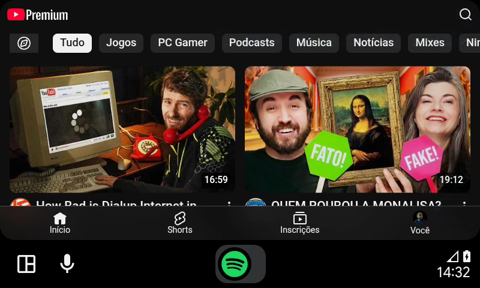
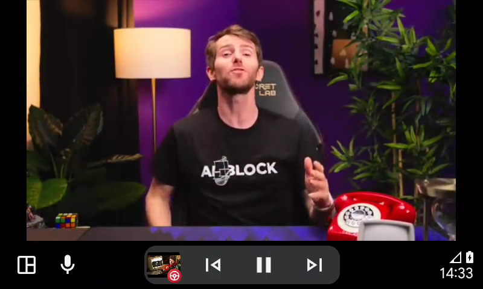
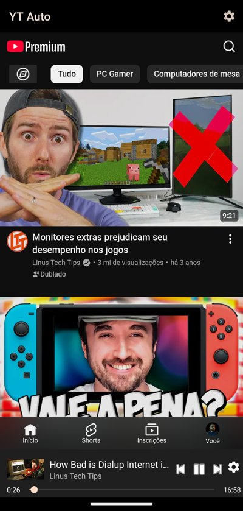
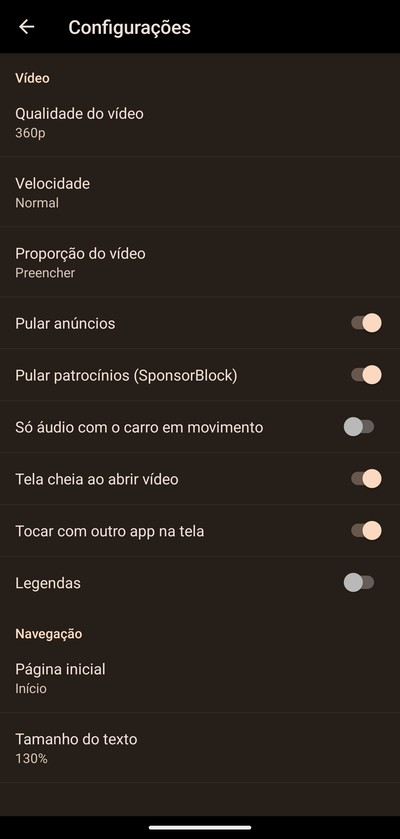
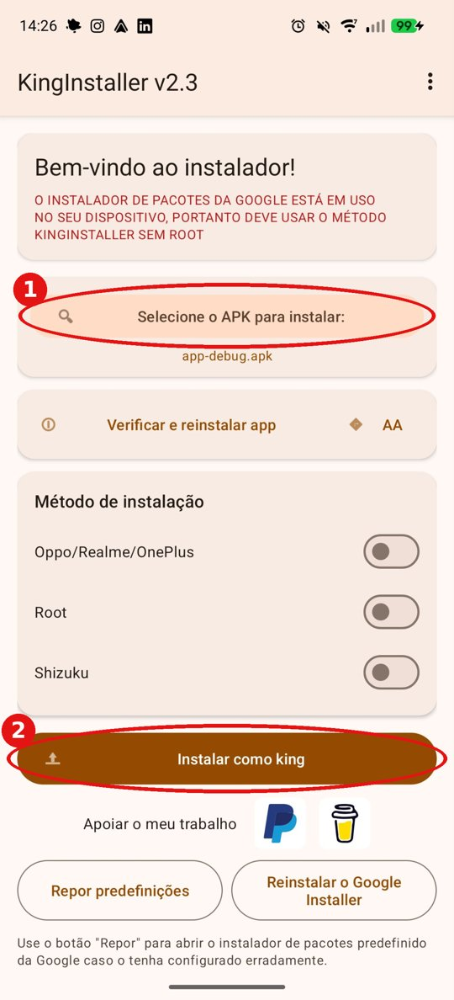

# YT Auto

**English** · [Português (Brasil)](README.pt-BR.md)

Watch YouTube on your car's Android Auto screen. YT Auto shows the YouTube mobile site on the car display,
with your account, subscriptions and history, and turns your phone into a remote control.

> [!WARNING]
> **Watching videos while driving is dangerous and, depending on your country, may be illegal.**
> Use it only while parked, or let a passenger handle it. **Use at your own risk: the author takes no
> responsibility** for fines, accidents, damage or any other consequence of using this app.
> See also the [license](LICENSE) ("THE SOFTWARE IS PROVIDED AS IS, WITHOUT WARRANTY OF ANY KIND").

| Home page in the car | Video playing in the car |
|---|---|
|  |  |

| Phone app (sign-in + remote control) | Phone settings |
|---|---|
|  |  |

## Features

- YouTube home page, subscriptions, history and search in the car (search uses the car keyboard).
- Sign in once on the phone; the car uses the same session.
- Phone remote: tap a video on the phone and it plays in the car; play/pause, next, seek, 10 s back/forward and
  settings from the phone bar.
- Share to the car: in the YouTube app (or any app), Share > YT Auto plays the link in the car.
- Voice: "Hey Google, play <something> on YT Auto" plays the first search result.
- Android Auto now-playing card (with 10 s back/forward) and steering wheel buttons (play/pause, next, previous).
- History, Subscriptions, Watch later, Liked videos and your playlists in Android Auto's media browser.
- Video fills the car screen by default; the aspect button (fit / fill / stretch) remembers your pick.
- Skips sponsor segments with [SponsorBlock](https://sponsor.ajay.app) (only a 4-character hash prefix of the
  video id is sent).
- Optional audio-only mode while the car is moving (uses the phone's GPS speed; off by default).
- Tells you when a new version is out on GitHub.
- Settings: video quality, speed, aspect (fit / fill / stretch), captions, fullscreen on open, home page, text size.
- Resumes the video where it stopped when the car reconnects.
- Languages: English, Português (Brasil), Español, Français, Italiano, Русский and العربية. The app follows the
  phone's language and falls back to English.

## Requirements

- Android 10 or newer.
- Android Auto (phone projection) or a car/head unit with Android Auto.
- A YouTube account (YouTube Premium avoids ads).

## Installation

YT Auto is not on the Play Store (Google does not allow video apps on Android Auto). Android Auto also hides
apps that were not installed by the Play Store, so a plain APK install won't show up in the car. **KingInstaller**
solves this: it installs the APK as if it came from the Play Store.

### 1. Download the files

- **YT Auto**: the latest `.apk` from this repository's [Releases](../../releases) page.
- **KingInstaller**: the latest `.apk` from <https://github.com/fcaronte/KingInstaller/releases>.

### 2. Install KingInstaller

Open the KingInstaller APK on the phone and install it (allow "install unknown apps" for your browser or file
manager if asked).

### 3. Install YT Auto with KingInstaller



1. Open KingInstaller and tap **Select the APK to install** (1). Pick the YT Auto `.apk` you downloaded.
2. Leave the install methods (Oppo/Realme/OnePlus, Root, Shizuku) **off**.
3. Tap **Install as King** (2) and confirm.

The screenshot shows KingInstaller in Portuguese: "Selecione o APK para instalar" is (1) and
"Instalar como king" is (2).

<br clear="right">

### 4. Use it

1. Open **YT Auto** on the phone and sign in to your YouTube account.
2. Connect the phone to the car and open **YT Auto** from the Android Auto launcher.

Updates: install the new APK with KingInstaller the same way. Your sign-in and settings are kept.

## Building from source

Requires JDK 17 and the Android SDK.

```bash
./gradlew testDebugUnitTest   # unit tests
./gradlew assembleRelease     # app/build/outputs/apk/release/yt-auto-<version>-release.apk
```

To test without a car, use the [Desktop Head Unit (DHU)](https://developer.android.com/training/cars/testing/dhu).

## How it works

Android Auto only gives a drawing surface to navigation apps, so YT Auto registers as one and renders a
WebView with `m.youtube.com` onto the car display. It depends on YouTube's mobile site, so a change on
YouTube's side can break features until the app is updated.

## Disclaimer

This is an unofficial project, not affiliated with or endorsed by Google, YouTube or Android Auto. "YouTube" and
"Android Auto" are trademarks of Google LLC.

## License

[MIT](LICENSE)
