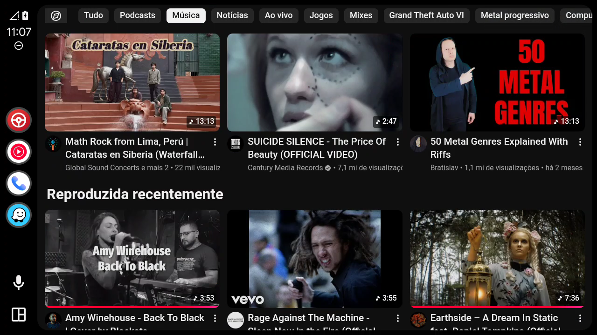
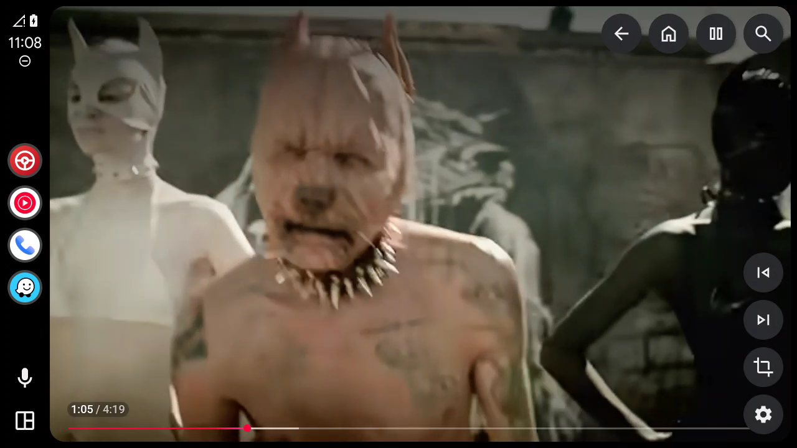
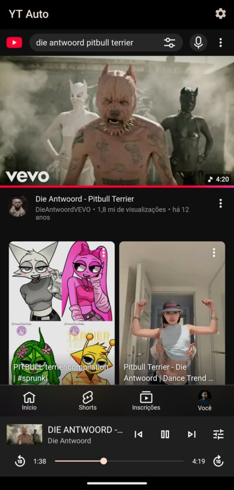
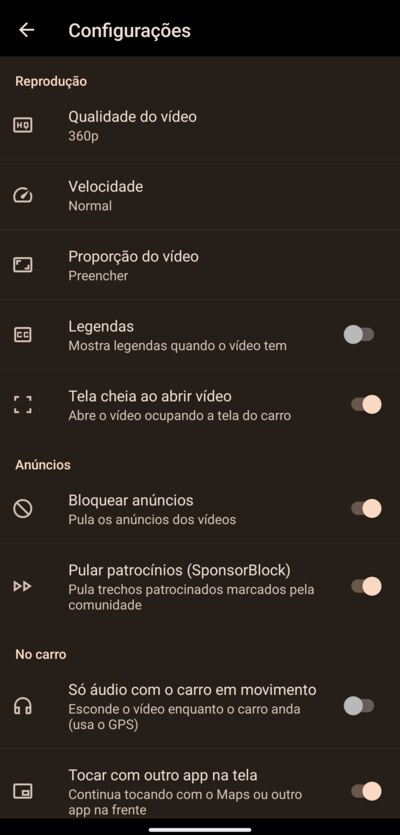
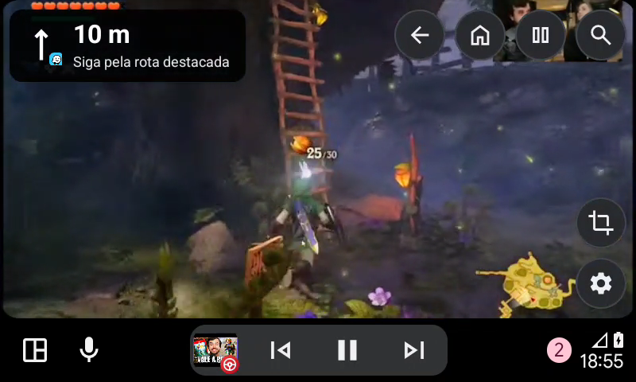
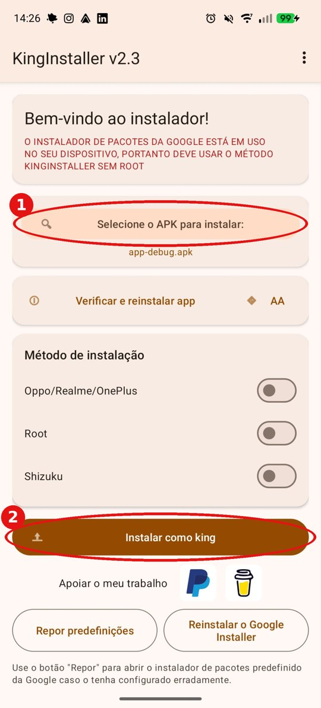

# YT Auto

[](https://github.com/begati/yt-auto/releases)
[](https://github.com/begati/yt-auto/stargazers)
[](https://github.com/begati/yt-auto/releases/latest)
[](LICENSE)

**English** · [Português (Brasil)](README.pt-BR.md) · [Español](README.es.md)

Watch YouTube on your car's Android Auto screen. YT Auto shows the YouTube mobile site on the car display,
with your account, subscriptions and history, and turns your phone into a remote control.

> [!WARNING]
> **Watching videos while driving is dangerous and, depending on your country, may be illegal.**
> Use it only while parked, or let a passenger handle it. **Use at your own risk: the author takes no
> responsibility** for fines, accidents, damage or any other consequence of using this app.
> See also the [license](LICENSE) ("THE SOFTWARE IS PROVIDED AS IS, WITHOUT WARRANTY OF ANY KIND").

| YouTube home page in the car | Video playing in the car |
|---|---|
|  |  |

| Phone app (YouTube + remote control) | Phone settings |
|---|---|
|  |  |

| Next Waze turn over the video |
|---|
|  |

## Features

- YouTube home page, subscriptions, history and search in the car (search uses the car keyboard).
- Touch gestures on the car screen: double tap to skip 10 s, tap the progress bar to jump, drag sideways to seek
  (see [On the car screen](#on-the-car-screen)).
- No account needed; sign in once on the phone (optional) and the car uses the same session.
- Phone remote: tap a video on the phone and it plays in the car; play/pause, next, seek, 10 s back/forward and
  settings from the phone bar.
- Share to the car: in the YouTube app (or any app), Share > YT Auto plays the link in the car.
- Voice: "Hey Google, play <something> on YT Auto" plays the first search result.
- Android Auto now-playing card (with 10 s back/forward) and steering wheel buttons (play/pause, next, previous).
- History, Subscriptions, Watch later, Liked videos and your playlists in Android Auto's media browser.
- Video fills the car screen by default; the aspect button (fit / fill / stretch) remembers your pick.
- When a video ends and nothing plays next, a 5 s countdown goes back to your home page.
- Skips sponsor segments with [SponsorBlock](https://sponsor.ajay.app) (only a 4-character hash prefix of the
  video id is sent).
- Optional audio-only mode while the car is moving (uses the phone's GPS speed; off by default).
- Turn-by-turn over the video: while Waze or Google Maps navigates, the next turn (icon, distance and instruction)
  shows at the top left of the car screen. Android Auto hides their turn card while YT Auto is open, so the app reads
  it from their notification. On by default; it needs notification access once: in the phone settings, turn on On-screen
  navigation and allow it. Turn it off in the phone or car settings.
- Tells you when a new version is out on GitHub.
- Blocks YouTube ads (videos start without the ad wait) and hides promoted items in the feed.
- Settings: video quality, speed, aspect (fit / fill / stretch), captions, fullscreen on open, home page, text size,
  on-screen navigation.
- Resumes the video where it stopped when the car reconnects.
- Languages: English, Português (Brasil), Español, Français, Italiano, Deutsch, Polski, Türkçe, Bahasa Indonesia,
  Русский and العربية. The app follows the phone's language and falls back to English.

## Requirements

- Android 10 or newer.
- Android Auto (phone projection) or a car/head unit with Android Auto.
- A YouTube account is optional (needed for subscriptions, history and playlists).

## Installation

YT Auto is not on the Play Store (Google does not allow video apps on Android Auto). Android Auto also hides
apps that were not installed by the Play Store, so a plain APK install won't show up in the car. **KingInstaller**
solves this: it installs the APK as if it came from the Play Store.

### 1. Download the files

- **YT Auto**: the latest `.apk` from this repository's [Releases](../../releases) page.
- **KingInstaller**: the latest `.apk` from <https://github.com/fcaronte/KingInstaller/releases>.

### 2. Install KingInstaller

Open the KingInstaller APK on the phone and install it (allow "install unknown apps" for your browser or file
manager if asked).

### 3. Install YT Auto with KingInstaller



1. Open KingInstaller and tap **Select the APK to install** (1). Pick the YT Auto `.apk` you downloaded.
2. Leave the install methods (Oppo/Realme/OnePlus, Root, Shizuku) **off**.
3. Tap **Install as King** (2) and confirm.

The screenshot shows KingInstaller in Portuguese: "Selecione o APK para instalar" is (1) and
"Instalar como king" is (2).

<br clear="right">

### 4. Use it

1. Open **YT Auto** on the phone. To use your YouTube account, tap **Sign in** on the banner at the top (optional; sign-in only works on the phone, the car uses the same account).
2. Connect the phone to the car and open **YT Auto** from the Android Auto launcher.

Updates: install the new APK with KingInstaller the same way. Your sign-in and settings are kept.

### On the car screen

Tap the page as on a phone. A tap also brings up the car's buttons for a few seconds: back, home menu, play/pause
and search at the top, video aspect and settings on the side. While a video plays, the car screen has no buttons of
its own for seeking; use these gestures:

- **Double tap** the right half of the video to skip 10 s forward, the left half to go 10 s back. Double tap again
  to keep adding 10 s.
- **Tap the progress bar** (tap the video first to show YouTube's controls) to jump to that point.
- **Drag sideways** across the video to seek: the screen's width is the whole video. The target time shows while you
  drag, and the video jumps there when you let go.
- **Drag up or down** to scroll the page.

The car settings have a **Gestures** row that explains these again.

The steering wheel buttons (play/pause, next, previous) and the Android Auto media card also control the video.

### The car shows "Open YT Auto from the car's app list"

That screen is YT Auto's media player, not the video screen. Android Auto hides the video screen of apps that
weren't installed from the Play Store, which is what KingInstaller works around. Where that doesn't work (for
example on GrapheneOS), turn on **Unknown sources** in Android Auto. Unlocking developer mode alone is not enough:
Unknown sources is a separate switch inside it.

1. Open Android Auto's settings on the phone (on GrapheneOS: **Settings** > **Apps** > **Android Auto**) and tap
   **Version** 10 times to unlock the developer settings.
2. In Android Auto, open the **⋮** menu > **Developer settings** and turn on **Unknown sources** (it is further
   down the list).
3. Restart the phone and reconnect it to the car.
4. In the car, open YT Auto from Android Auto's app list (the grid icon), not from the media card.

Still missing? In Android Auto's settings on the phone, open **Customize launcher** and check that YT Auto is ticked.
If you installed the APK without KingInstaller, install it again with KingInstaller.

## Building from source

Requires JDK 17 and the Android SDK.

```bash
./gradlew testDebugUnitTest   # unit tests
./gradlew assembleRelease     # app/build/outputs/apk/release/yt-auto-<version>-release.apk
```

To test without a car, use the [Desktop Head Unit (DHU)](https://developer.android.com/training/cars/testing/dhu).

## How it works

Android Auto only gives a drawing surface to navigation apps, so YT Auto registers as one and renders a
WebView with `m.youtube.com` onto the car display. It depends on YouTube's mobile site, so a change on
YouTube's side can break features until the app is updated.

## Disclaimer

This is an unofficial project, not affiliated with or endorsed by Google, YouTube or Android Auto. "YouTube" and
"Android Auto" are trademarks of Google LLC.

## License

[MIT](LICENSE)
