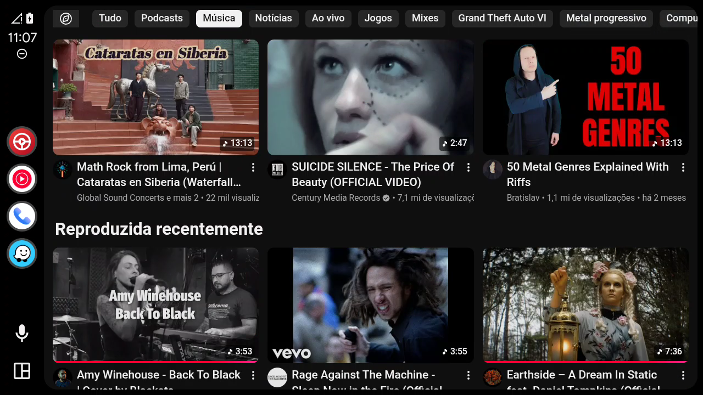
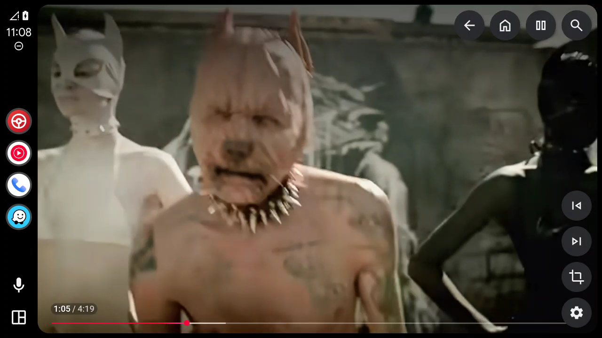
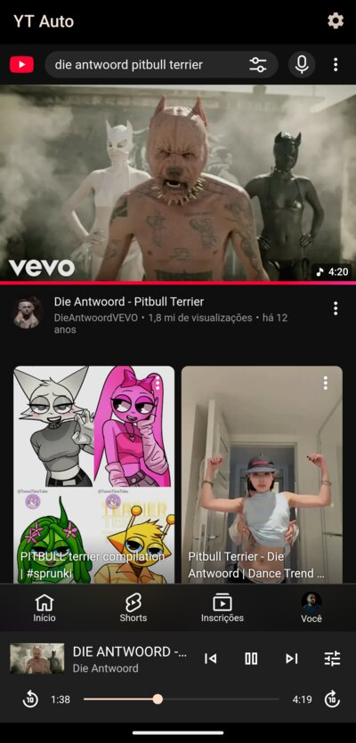
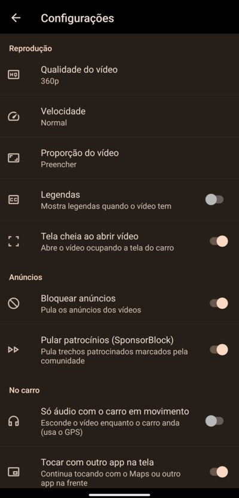
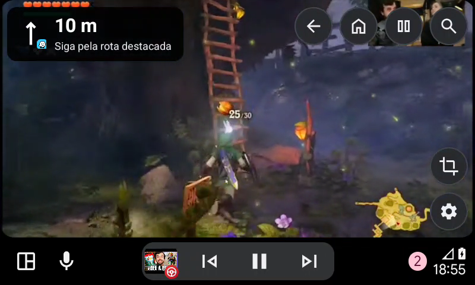
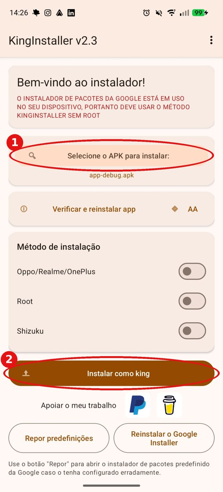

# YT Auto

[](https://github.com/begati/yt-auto/releases)
[](https://github.com/begati/yt-auto/stargazers)
[](https://github.com/begati/yt-auto/releases/latest)
[](LICENSE)

[English](README.md) · **Português (Brasil)** · [Español](README.es.md)

Assista ao YouTube na tela do carro pelo Android Auto. O YT Auto mostra o site mobile do YouTube na tela do carro,
com sua conta, inscrições e histórico, e transforma o celular em controle remoto.

> [!WARNING]
> **Assistir vídeos enquanto dirige é perigoso e, dependendo do país, pode ser proibido por lei.**
> Use só com o carro parado, ou deixe um passageiro controlar. **Use por sua conta e risco: o autor não se
> responsabiliza** por multas, acidentes, danos ou qualquer outra consequência do uso deste app.
> Veja também a [licença](LICENSE) ("THE SOFTWARE IS PROVIDED AS IS, WITHOUT WARRANTY OF ANY KIND").

| Página inicial do YouTube no carro | Vídeo tocando no carro |
|---|---|
|  |  |

| App no celular (YouTube + controle remoto) | Configurações no celular |
|---|---|
|  |  |

| Próxima curva do Waze por cima do vídeo |
|---|
|  |

## Recursos

- Página inicial, inscrições, histórico e pesquisa do YouTube no carro (a pesquisa usa o teclado do carro).
- Gestos na tela do carro: toque duplo para pular 10 s, toque na barra de progresso para ir ao ponto, arraste para
  o lado para avançar ou voltar (veja [Na tela do carro](#na-tela-do-carro)).
- Não precisa de conta; faça login uma vez no celular (opcional) e o carro usa a mesma sessão.
- Controle pelo celular: toque num vídeo no celular e ele toca no carro; tocar/pausar, próximo, barra de
  progresso, voltar/avançar 10 s e configurações pela barra do celular.
- Compartilhar para o carro: no app do YouTube (ou em qualquer app), Compartilhar > YT Auto toca o link no carro.
- Voz: "Ok Google, tocar <algo> no YT Auto" toca o primeiro resultado da busca.
- Card "tocando agora" do Android Auto (com voltar/avançar 10 s) e botões do volante (tocar/pausar, próximo,
  anterior).
- Histórico, Inscrições, Assistir mais tarde, Vídeos curtidos e suas playlists no navegador de mídia do Android Auto.
- O vídeo preenche a tela do carro por padrão; a proporção (ajustar / preencher / esticar) fica nas configurações do carro.
- Quando um vídeo termina e nada toca em seguida, uma contagem de 5 s volta para a sua página inicial.
- Pula patrocínios com o [SponsorBlock](https://sponsor.ajay.app) (só um prefixo de 4 caracteres do hash do id do
  vídeo é enviado).
- Modo só áudio opcional com o carro em movimento (usa a velocidade do GPS do celular; desligado por padrão).
- Curva a curva por cima do vídeo: com o Waze ou o Google Maps navegando, a próxima curva (ícone, distância e
  instrução) aparece no canto superior esquerdo da tela do carro. O Android Auto esconde o card deles com o YT Auto
  aberto, então o app lê a instrução da notificação. Ligado por padrão; precisa do acesso às notificações uma vez:
  nas configurações do celular, ligue Navegação na tela e permita. Desligue nas configurações do celular ou do carro.
- Avisa quando sai versão nova no GitHub.
- Bloqueia os anúncios do YouTube (o vídeo começa sem a espera do anúncio) e esconde os itens promovidos do feed.
- Configurações: qualidade, velocidade, proporção (ajustar / preencher / esticar), legendas, tela cheia ao abrir,
  página inicial, tamanho do texto, navegação na tela.
- Retoma o vídeo de onde parou quando o carro reconecta.
- Idiomas: English, Português (Brasil), Español, Français, Italiano, Deutsch, Polski, Türkçe, Bahasa Indonesia,
  Русский e العربية. O app segue o idioma do celular e usa inglês quando o idioma não é suportado; no Android 13
  ou mais novo, escolha outro em Configurações do celular > Apps > YT Auto > Idioma.

## Requisitos

- Android 10 ou mais novo.
- Android Auto (projeção do celular) ou carro/central multimídia com Android Auto.
- Uma conta do YouTube é opcional (necessária para inscrições, histórico e playlists).

## Instalação

O YT Auto não está na Play Store (o Google não permite apps de vídeo no Android Auto). O Android Auto também
esconde apps que não foram instalados pela Play Store, então instalar o APK direto não faz ele aparecer no carro.
O **KingInstaller** resolve isso: ele instala o APK como se tivesse vindo da Play Store.

### 1. Baixe os arquivos

- **YT Auto**: o `.apk` mais recente na página de [Releases](../../releases) deste repositório.
- **KingInstaller**: o `.apk` mais recente em <https://github.com/fcaronte/KingInstaller/releases>.

### 2. Instale o KingInstaller

Abra o APK do KingInstaller no celular e instale (se pedir, permita "instalar apps desconhecidos" para o navegador
ou gerenciador de arquivos).

### 3. Instale o YT Auto pelo KingInstaller



1. Abra o KingInstaller e toque em **Selecione o APK para instalar** (1). Escolha o `.apk` do YT Auto que você baixou.
2. Deixe os métodos de instalação (Oppo/Realme/OnePlus, Root, Shizuku) **desligados**.
3. Toque em **Instalar como king** (2) e confirme.

Em alguns celulares (por exemplo Pixel) essa instalação padrão não basta e o carro mostra só o player. Nesse caso,
reinstale pelo método **Shizuku** do KingInstaller (ou **Root** em celular com root); veja
[a solução de problemas abaixo](#o-carro-mostra-abra-o-yt-auto-pela-lista-de-apps-do-carro).

<br clear="right">

### 4. Use

1. Abra o **YT Auto** no celular. Para usar sua conta do YouTube, toque em **Entrar** no aviso do topo (opcional; o login só funciona no celular, e o carro usa a mesma conta).
2. Conecte o celular ao carro e abra o **YT Auto** pelo menu do Android Auto.

Atualizações: instale o APK novo pelo KingInstaller do mesmo jeito. Login e configurações são mantidos.

### Na tela do carro

Toque na página como no celular. Um toque também mostra os botões do carro por alguns segundos: voltar, início (a sua
página inicial), tocar/pausar e busca no topo, **Ir para** (Início, Inscrições, Histórico, Playlists) e configurações
na lateral. Num vídeo, a lateral tem **anterior**, **próximo** e configurações: o próximo só aparece quando o YouTube tem um próximo vídeo, e o anterior vai ao vídeo
anterior ou, se não houver, volta ao início do vídeo. Para andar dentro do vídeo, use estes gestos:

- **Toque duas vezes** na metade direita do vídeo para avançar 10 s, na metade esquerda para voltar 10 s. Repita o
  toque duplo para somar mais 10 s.
- **Toque na barra de progresso** (toque antes no vídeo para mostrar os controles do YouTube) para ir direto àquele
  ponto.
- **Arraste para o lado** sobre o vídeo para avançar ou voltar: a largura da tela é o vídeo inteiro. O tempo de
  destino aparece enquanto você arrasta, e o vídeo pula para lá quando você solta.
- **Arraste para cima ou para baixo** para rolar a página; fora de um vídeo, **arraste para o lado** para rolar os
  filtros no topo do feed.

Os primeiros vídeos mostram esses gestos num painel por alguns segundos. As configurações do carro têm a linha
**Ir para**, a proporção do vídeo e a linha **Gestos**, que explica os gestos de novo.

Os botões do volante (tocar/pausar, próximo, anterior) e o card de mídia do Android Auto também controlam o vídeo.

### O carro mostra "Abra o YT Auto pela lista de apps do carro"

Essa tela é o player de mídia do YT Auto, não a tela de vídeo. O Android Auto do carro esconde a tela de vídeo de
apps que ele acha que não vieram da Play Store. O KingInstaller grava a Play Store como instalador; instalar ou
atualizar o YT Auto de qualquer outro jeito (abrindo o APK direto, `adb install`, um gerenciador de arquivos) apaga
isso, e o carro volta a mostrar só o player. Essa é a causa mais comum. Siga os passos na ordem:

1. **Abra o YT Auto no celular.** Se aparecer "Reinstale pelo KingInstaller" no topo, o instalador se perdeu:
   toque em **Abrir KingInstaller** (ou **Baixar KingInstaller**) e vá para o passo 2. Se você permitiu as notificações dele,
   o YT Auto também mostra esse aviso quando o carro conecta.
2. **Reinstale pelo KingInstaller** (seção 3 acima). Faça o mesmo em toda atualização: nunca abra o APK novo direto.
3. **Ainda só o player?** Ao contrário da seção 3 acima, agora tente os outros métodos de instalação do KingInstaller (**Shizuku**, ou
   **Root** em celular com root) e conecte de novo ao carro.
4. **Ative Fontes desconhecidas no Android Auto** (necessário onde o KingInstaller não funciona, por exemplo no
   GrapheneOS): abra as configurações do Android Auto no celular (no GrapheneOS: **Configurações** > **Apps** >
   **Android Auto**), toque 10 vezes em **Versão** para liberar as configurações de desenvolvedor e depois em **⋮** >
   **Configurações do desenvolvedor** > **Fontes desconhecidas** (fica mais para baixo na lista; só o modo
   desenvolvedor não basta). Reinicie o celular e conecte de novo ao carro.
5. **Confira o inicializador:** nas configurações do Android Auto, abra **Personalizar inicializador** e confira se
   o YT Auto está marcado; no carro, abra o YT Auto pela lista de apps (ícone de grade), não pelo card de mídia.

## Compilando o código

Requer JDK 17 e o Android SDK.

```bash
./gradlew testDebugUnitTest   # testes unitários
./gradlew assembleRelease     # app/build/outputs/apk/release/yt-auto-<versão>-release.apk
```

Para testar sem carro, use a [Desktop Head Unit (DHU)](https://developer.android.com/training/cars/testing/dhu).

## Como funciona

O Android Auto só entrega uma superfície de desenho para apps de navegação, então o YT Auto se registra como um e
desenha uma WebView com o `m.youtube.com` na tela do carro. Ele depende do site mobile do YouTube, então uma mudança
do lado do YouTube pode quebrar recursos até o app ser atualizado.

## Aviso legal

Projeto não oficial, sem vínculo com Google, YouTube ou Android Auto, nem endossado por eles. "YouTube" e
"Android Auto" são marcas registradas da Google LLC.

## Licença

[MIT](LICENSE)
