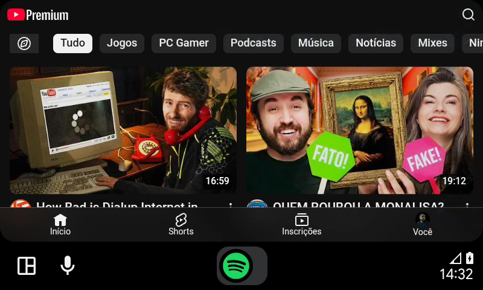
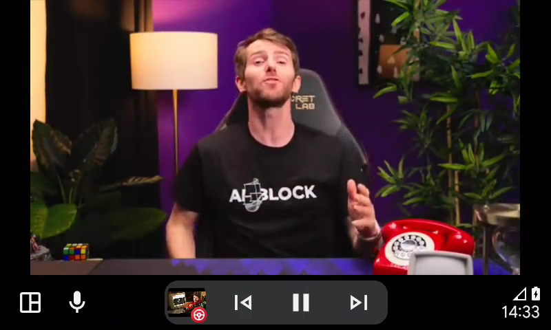
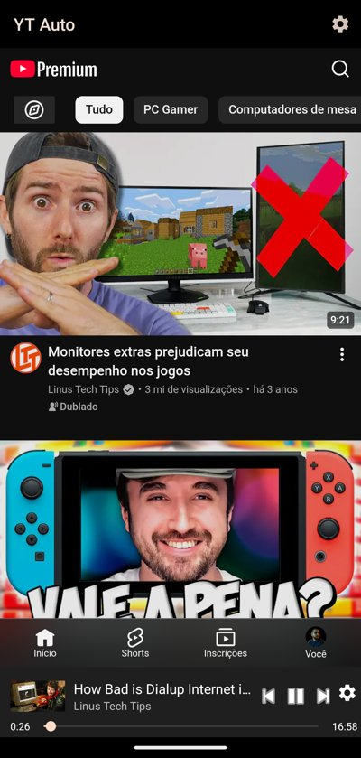
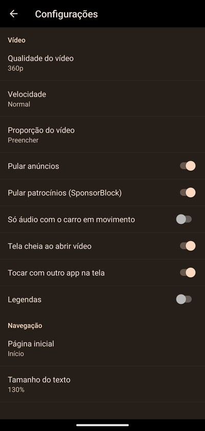
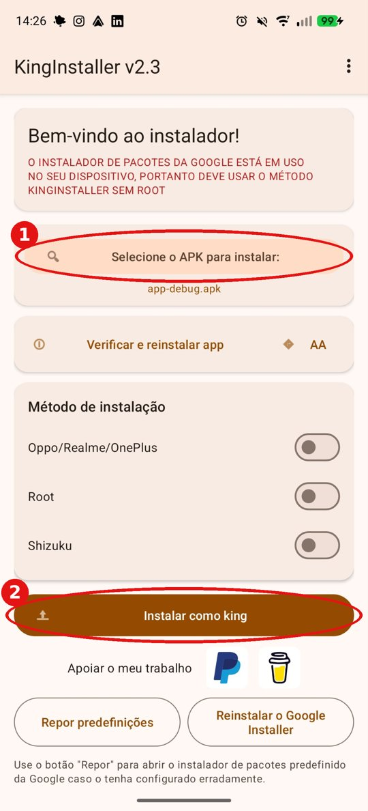

# YT Auto

[](https://github.com/begati/yt-auto/releases)
[](https://github.com/begati/yt-auto/stargazers)
[](https://github.com/begati/yt-auto/releases/latest)
[](LICENSE)

[English](README.md) · **Português (Brasil)**

Assista ao YouTube na tela do carro pelo Android Auto. O YT Auto mostra o site mobile do YouTube na tela do carro,
com sua conta, inscrições e histórico, e transforma o celular em controle remoto.

> [!WARNING]
> **Assistir vídeos enquanto dirige é perigoso e, dependendo do país, pode ser proibido por lei.**
> Use só com o carro parado, ou deixe um passageiro controlar. **Use por sua conta e risco: o autor não se
> responsabiliza** por multas, acidentes, danos ou qualquer outra consequência do uso deste app.
> Veja também a [licença](LICENSE) ("THE SOFTWARE IS PROVIDED AS IS, WITHOUT WARRANTY OF ANY KIND").

| Página inicial no carro | Vídeo tocando no carro |
|---|---|
|  |  |

| App no celular (login + controle remoto) | Configurações no celular |
|---|---|
|  |  |

## Recursos

- Página inicial, inscrições, histórico e pesquisa do YouTube no carro (a pesquisa usa o teclado do carro).
- Login uma vez no celular; o carro usa a mesma sessão.
- Controle pelo celular: toque num vídeo no celular e ele toca no carro; tocar/pausar, próximo, barra de
  progresso, voltar/avançar 10 s e configurações pela barra do celular.
- Compartilhar para o carro: no app do YouTube (ou em qualquer app), Compartilhar > YT Auto toca o link no carro.
- Voz: "Ok Google, tocar <algo> no YT Auto" toca o primeiro resultado da busca.
- Card "tocando agora" do Android Auto (com voltar/avançar 10 s) e botões do volante (tocar/pausar, próximo,
  anterior).
- Histórico, Inscrições, Assistir mais tarde, Vídeos curtidos e suas playlists no navegador de mídia do Android Auto.
- O vídeo preenche a tela do carro por padrão; o botão de proporção (ajustar / preencher / esticar) lembra a escolha.
- Pula patrocínios com o [SponsorBlock](https://sponsor.ajay.app) (só um prefixo de 4 caracteres do hash do id do
  vídeo é enviado).
- Modo só áudio opcional com o carro em movimento (usa a velocidade do GPS do celular; desligado por padrão).
- Avisa quando sai versão nova no GitHub.
- Configurações: qualidade, velocidade, proporção (ajustar / preencher / esticar), legendas, tela cheia ao abrir,
  página inicial, tamanho do texto.
- Retoma o vídeo de onde parou quando o carro reconecta.
- Idiomas: English, Português (Brasil), Español, Français, Italiano, Русский e العربية. O app segue o idioma do
  celular e usa inglês quando o idioma não é suportado.

## Requisitos

- Android 10 ou mais novo.
- Android Auto (projeção do celular) ou carro/central multimídia com Android Auto.
- Uma conta do YouTube (com YouTube Premium não há anúncios).

## Instalação

O YT Auto não está na Play Store (o Google não permite apps de vídeo no Android Auto). O Android Auto também
esconde apps que não foram instalados pela Play Store, então instalar o APK direto não faz ele aparecer no carro.
O **KingInstaller** resolve isso: ele instala o APK como se tivesse vindo da Play Store.

### 1. Baixe os arquivos

- **YT Auto**: o `.apk` mais recente na página de [Releases](../../releases) deste repositório.
- **KingInstaller**: o `.apk` mais recente em <https://github.com/fcaronte/KingInstaller/releases>.

### 2. Instale o KingInstaller

Abra o APK do KingInstaller no celular e instale (se pedir, permita "instalar apps desconhecidos" para o navegador
ou gerenciador de arquivos).

### 3. Instale o YT Auto pelo KingInstaller



1. Abra o KingInstaller e toque em **Selecione o APK para instalar** (1). Escolha o `.apk` do YT Auto que você baixou.
2. Deixe os métodos de instalação (Oppo/Realme/OnePlus, Root, Shizuku) **desligados**.
3. Toque em **Instalar como king** (2) e confirme.

<br clear="right">

### 4. Use

1. Abra o **YT Auto** no celular e faça login na sua conta do YouTube.
2. Conecte o celular ao carro e abra o **YT Auto** pelo menu do Android Auto.

Atualizações: instale o APK novo pelo KingInstaller do mesmo jeito. Login e configurações são mantidos.

## Compilando o código

Requer JDK 17 e o Android SDK.

```bash
./gradlew testDebugUnitTest   # testes unitários
./gradlew assembleRelease     # app/build/outputs/apk/release/yt-auto-<versão>-release.apk
```

Para testar sem carro, use a [Desktop Head Unit (DHU)](https://developer.android.com/training/cars/testing/dhu).

## Como funciona

O Android Auto só entrega uma superfície de desenho para apps de navegação, então o YT Auto se registra como um e
desenha uma WebView com o `m.youtube.com` na tela do carro. Ele depende do site mobile do YouTube, então uma mudança
do lado do YouTube pode quebrar recursos até o app ser atualizado.

## Aviso legal

Projeto não oficial, sem vínculo com Google, YouTube ou Android Auto, nem endossado por eles. "YouTube" e
"Android Auto" são marcas registradas da Google LLC.

## Licença

[MIT](LICENSE)
